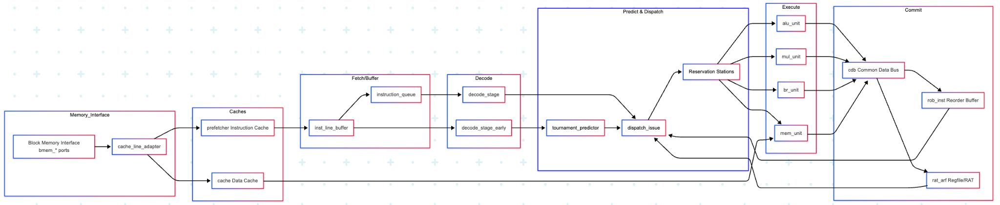
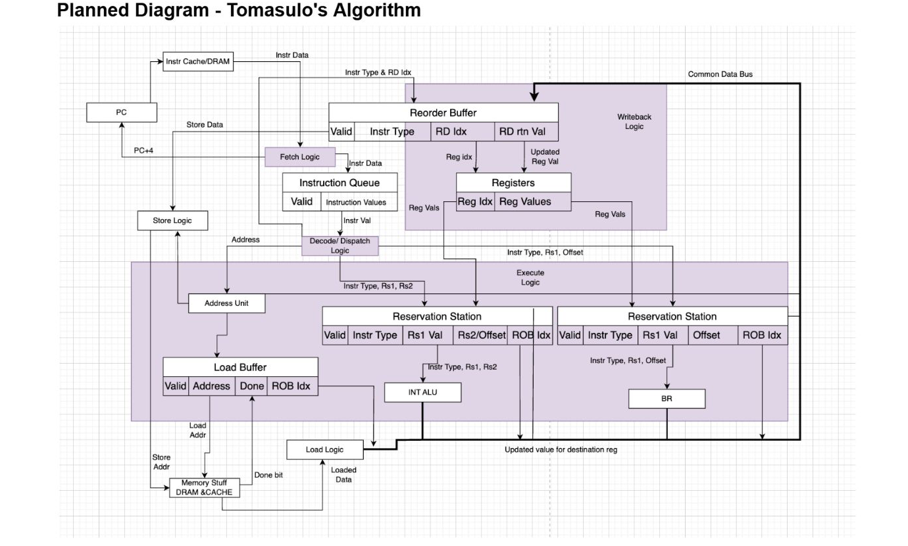
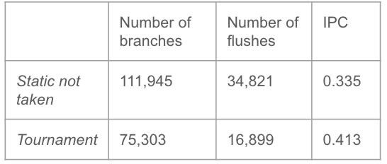
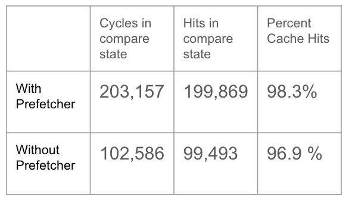

# Apex-RV: Out-of-order RISC-V processor

[](https://en.wikipedia.org/wiki/SystemVerilog)
[-orange.svg)](https://riscv.org/)
[](#fpga-synthesis-and-timing)
[-brightgreen.svg)](#timing-report)
[](#microarchitecture-overview)

Apex-RV is a 32-bit out-of-order RISC-V processor core written in SystemVerilog for an FPGA. Our team built it around Tomasulo's algorithm with a reorder buffer (ROB) for in-order commit, register renaming through an alias table (RAT), and a multi-channel common data bus (CDB).

On top of the base out-of-order pipeline, we added a tournament branch predictor (GSelect plus a two-level adaptive predictor), an L1 instruction prefetcher, a post-commit store buffer with store-to-load forwarding, and split queues for memory operations. Across benchmarks (`coremark`, `aes_sha`, `compression`, `fft`, and `mergesort`), these changes roughly doubled our IPC compared to our early pipeline, while hitting 100 MHz with 1.238 ns of positive slack.

## Architecture summary

- Out-of-order execution with Tomasulo's algorithm, using a reorder buffer (ROB) for precise state and in-order retirement.
- Register renaming with an architectural register file (ARF) and register alias table (RAT), removing WAR and WAW register hazards.
- Common data bus broadcasting tags and values to reservation stations and the ROB on the same cycle execution completes.
- Dual-stage decode, including an early decode block that pulls branch targets directly from the line buffer to keep the branch predictor ahead of the pipeline.
- Tournament branch predictor using a 4-bit chooser between GSelect and two-level adaptive prediction, cutting branch flushes by 51.4% on CoreMark.
- L1 cache system with a next-line prefetcher on instruction fetch and a burst memory adapter (`bmem_*`) that converts 64-bit DRAM beats into 256-bit cache lines.
- Split load-store queue (LSQ) separating load and store stations to prevent false ordering stalls.
- Post-commit store buffer with address coalescing and direct store-to-load forwarding.
- Synthesized for FPGA at 100 MHz with 1.238 ns slack, achieved by restructuring reservation station arbitration into a queue rather than full matrix comparisons.

## Microarchitecture overview

### Pipeline structure

We broke the pipeline into decoupled stages connected with valid-ready handshakes and FIFO queues so back-end stalls do not immediately back up fetch.



1. Memory interface: Connects to 64-bit burst DRAM over `bmem_*` signals. A `cache_line_adapter` serializes and deserializes data between the memory bus and the 256-bit cache lines.
2. Caches: A dedicated instruction cache feeds from the prefetcher, while the data cache connects to the memory execution unit and the store buffer.
3. Fetch and line buffer: `inst_line_buffer` holds raw data coming from the instruction cache. Instructions flow into a parameterized `instruction_queue` FIFO, isolating fetch from decode stalls.
4. Dual decode paths: Standard decode (`decode_stage`) unpacks instructions from the queue, resolving register indices and immediate formats for dispatch. An early decode block (`decode_stage_early`) sits directly on the line buffer, pulling branch targets and opcode fields a cycle earlier so the tournament predictor does not lag behind fetch.
5. Predict and dispatch: Checks the RAT for each source register to grab either the committed ARF data or an in-flight ROB tag. It allocates the next slot in the ROB and pushes the instruction into the target reservation station.
6. Execution units: Four independent functional units run in parallel:
   - `alu_unit`: Single-cycle integer arithmetic, logic, and shifts.
   - `mul_unit`: Multi-cycle hardware multiplier.
   - `br_unit`: Branch condition evaluation and target address check.
   - `mem_unit`: Address generation and interface to load-store buffers.
7. Writeback and commit: When a functional unit finishes, it requests the common data bus (`cdb`). The bus broadcasts tag-data pairs to waiting reservation stations and the reorder buffer (`rob_inst`). The ROB retires instructions strictly in program order, writes results to the register file (`rat_arf`), and drains committed writes from the store buffer.

### Tomasulo execution engine

Our initial floorplan followed Tomasulo's algorithm with a speculative reorder buffer:



When an instruction dispatches, its source registers look up the RAT. If an older in-flight instruction produces that register, the RAT supplies the ROB tag; otherwise, the instruction takes the value from the ARF. Once operands are ready, the station issues to its functional unit. If operands are still pending, the station snoops the CDB and grabs incoming values the moment their tag appears.

We also separated dispatch from functional unit availability. Instructions can dispatch into an open reservation station even when the execution unit is busy with earlier work.

## Optimizations and tuning

### Tournament branch predictor (GSelect and two-level)

Flushing the ROB, RAT, reservation stations, and instruction buffers on a mispredicted branch is expensive. We tested static not-taken early on and saw too many flushes, so we built a hybrid tournament predictor:

- GSelect predictor: Hashes the global branch history register with PC bits to index a pattern history table, which catches correlated branches in loops and control flow.
- Two-level adaptive predictor: Uses local per-branch history tables, which works better for independent loop exits.
- Chooser: A table of 4-bit saturating counters indexed by branch PC. If the two predictors give different predictions, the counter increments toward the correct one and decrements away from the wrong one.



Measurements on `coremark_im`:

| Predictor | Branches | Flushes | IPC |
| :--- | :---: | :---: | :---: |
| Static not-taken | 111,945 | 34,821 | 0.335 |
| Tournament | 75,303 | 16,899 | 0.413 |

The tournament predictor cut misprediction flushes by 51.4% and raised CoreMark IPC by 23.3%.

### Next-line instruction cache prefetcher

In our early tests, reservation stations emptied frequently because the front end could not deliver instructions quickly enough after a miss. We added a next-line prefetcher between the L1 instruction cache and the cache line adapter. When cache line $N$ is requested, the prefetcher checks for line $N+1$ and fetches it during idle bus cycles before the core requests it.



Measurements on `coremark_im`:

| Configuration | Compare state cycles | Compare state hits | Hit rate |
| :--- | :---: | :---: | :---: |
| Without prefetcher | 102,586 | 99,493 | 96.9% |
| With prefetcher | 203,157 | 199,869 | 98.3% |

Prefetching increased cache hits in the compare state and brought overall instruction cache hit rate to 98.3%, keeping the instruction queue populated.

### Post-commit store buffer and forwarding

Stores cannot write to cache or memory speculatively. If stores stayed in the ROB until DRAM acknowledged the write, the commit head would stall for several cycles on every store instruction.

We added an asynchronous circular store buffer past the commit stage:
- Stores retire from the ROB as soon as they reach the head of the buffer, freeing the ROB entry for younger instructions.
- When younger loads calculate their address, they snoop the store buffer while checking the L1 data cache. If an unwritten store has the same address, the store buffer forwards the data directly to the load without waiting for cache writes.
- Consecutive stores to the same cache block merge into one transaction, cutting down memory bus traffic.

### Split load-store queue

Instead of a single queue for all memory operations, we split load and store reservation stations into separate queues. Loads do not get held up behind unrelated pending stores, and checking address dependencies is simpler. When a load is ready to issue, the logic only checks whether an older store in program order has an overlapping or unresolved address.

### Age-ordered issue scheduling

Our first scheduler compared the arrival time of every reservation station against every other station to find the oldest ready instruction. That comparison matrix created a wide combinational delay path and limited our clock speed.

We replaced the full matrix with a queue-like priority chain. The head pointer tracks the most likely oldest station. If that station is blocked on an unresolved operand, the issue logic ripples down to the next ready station. This eliminated the deep comparator tree on our dispatch path and let us close timing at 100 MHz.

### Compressed instruction extension (RV32C)

We built an experimental decoder for 16-bit compressed instructions. It runs parallel to the main 32-bit decoder and expands 16-bit instructions into internal RV32I equivalents in one cycle. We kept this implementation on a separate branch because the extra multiplexing and decode logic added significant FPGA area when combined with the rest of the out-of-order engine.

## Benchmark results

We tested the processor on five programs: `coremark`, `aes_sha`, `compression`, `fft`, and `mergesort`. We added hardware performance counters to the commit and cache stages to record cycles, instructions retired, cache hits, and flushes.

### Baseline vs. final performance

| Benchmark | Baseline IPC | Final IPC | Change | Baseline delay (ps) | Final $DP^2$ |
| :--- | :---: | :---: | :---: | :---: | :---: |
| `coremark` | 0.2102 | 0.4131 | +96.5% | 13,870,820,000 | 37,283.25 |
| `aes_sha` | 0.1923 | 0.4077 | +112.0% | 40,345,330,000 | 1,953,559.83 |
| `compression` | 0.2163 | 0.5678 | +162.5% | 22,273,410,000 | 49,858.68 |
| `fft` | 0.1922 | 0.4251 | +121.2% | 60,419,880,000 | 8,243,623.53 |
| `mergesort` | 0.2284 | 0.4221 | +84.8% | 18,388,980,000 | 256,849.65 |

```
Benchmark IPC comparison (baseline vs final)
========================================================================
coremark     [██████████ 0.210]  --->  [████████████████████ 0.413]   (+96.5%)
aes_sha      [█████████ 0.192]   --->  [████████████████████ 0.408]   (+112.0%)
compression  [██████████ 0.216]  --->  [████████████████████████████ 0.568] (+162.5%)
fft          [█████████ 0.192]   --->  [████████████████████ 0.425]   (+121.2%)
mergesort    [███████████ 0.228] --->  [████████████████████ 0.422]   (+84.8%)
========================================================================
```

The compression benchmark saw the largest gain (+162.5%) because its tight loop has sequential memory accesses that the next-line prefetcher and store buffer handled cleanly without stalling the ROB. On `aes_sha` and `fft`, the tournament predictor was the main contributor, cutting branch resolution latency on long inner loops.

## FPGA synthesis and timing

We targeted a 100 MHz clock (10.0 ns period) for FPGA synthesis.

```text
================================================================================
Timing report (Target: 100 MHz)
================================================================================
Clock period:              10.000000 ns
Data required time:         9.958930 ns
Data arrival time:         -8.720723 ns
--------------------------------------------------------------------------------
Slack (MET):               +1.238207 ns
================================================================================
```

### Area breakdown

```text
================================================================================
Area report
================================================================================
Combinational area:                 71,657.47  units
Non-combinational area:             60,164.14  units
Macro / black box area:             79,531.08  units
Buffer / inverter area:              5,322.66  units
--------------------------------------------------------------------------------
Total cell area:                   211,352.70  units
================================================================================
```

## Practical issues and bug fixes

### Reservation station depth

Area limits on the FPGA forced us to cut reservation station depth from 8 entries down to 4 entries for every functional unit except the ALU. We expected IPC to drop as a result, but it actually improved. With 8 entries, our queue-based arbiter took longer to find the true oldest instruction when entries in between were stalled on operands. With 4 entries, the queue had less internal fragmentation, ready instructions dispatched sooner, and we saved considerable logic area.

### Removing execution unit stalls

Early in development, we added an artificial stall every other cycle to keep multi-cycle units (like the multiplier and memory stage) from getting preempted mid-execution. It prevented race conditions, but it cut our maximum throughput in half. Once we rewrote the issue stage to use explicit valid-ready handshakes for each functional unit, we removed the stall cycle entirely and let instructions issue on consecutive cycles whenever units were free.

### Moving combinational logic out of clocked blocks

Our first synthesis runs failed timing badly because we had placed wide immediate-generation and control-decode logic inside clocked `always_ff` blocks. That created long propagation delays before the flip-flop setup times. We pulled those decoding paths out into dedicated combinational early-decode stages with their own pipeline registers, which fixed the negative slack.

### Memory bus handshake bug

During burst reads, `bmem_read` stayed asserted for multiple cycles after memory granted access. The DRAM controller interpreted each cycle as a new read request, corrupting cache fills. We added an edge-triggered handshake flag in the cache line adapter so that each cache miss triggers exactly one pulse on `bmem_read`.

## Repository structure

```text
.
├── docs/
│   └── images/
│       ├── pipeline_architecture.png     # Pipeline block diagram
│       ├── tomasulo_diagram.png          # Planned Tomasulo floorplan
│       ├── branch_predictor_stats.png    # Branch predictor comparison
│       └── prefetcher_stats.png          # Instruction prefetcher hit rates
├── hdl/
│   ├── cpu.sv                            # Top-level CPU core
│   ├── datapath/
│   │   ├── fetch/                        # Fetch, line buffer, instruction queue
│   │   ├── decode/                       # Standard and early decode stages
│   │   ├── dispatch/                     # RAT, reservation station allocation
│   │   ├── execute/                      # ALU, multiplier, branch, memory units
│   │   └── commit/                       # Reorder buffer, ARF, CDB logic
│   ├── branch_prediction/
│   │   ├── tournament_predictor.sv       # Chooser table and top-level predictor
│   │   ├── gselect.sv                    # Global history predictor
│   │   └── two_level.sv                  # Local two-level adaptive predictor
│   └── memory/
│       ├── cache_line_adapter.sv         # DRAM burst deserializer
│       ├── prefetcher.sv                 # Next-line instruction prefetcher
│       ├── l1_icache.sv                  # L1 instruction cache
│       ├── l1_dcache.sv                  # L1 data cache
│       └── store_buffer.sv               # Post-commit ring buffer with forwarding
├── sim/                                  # Testbenches and verification harness
└── synth/                                # Synthesis scripts, constraints, and reports
```

## Team and workflow

Our team split responsibilities across the core modules:
- Alex: Instruction queue, cache line adapter, memory subsystem, and system verification.
- Erin: Datapath planning, fetch stage, and architecture diagrams.
- Sujin: Early decode block, instruction fetch buffers, and hardware testbenches.

We used VSCode Live Share for pair programming sessions when tracking down CDB arbitration bugs and clearing synthesis lint warnings. For experimental additions like the compressed instruction decoder and split LSQ, we developed them on isolated Git branches to test their timing and FPGA area impact before merging them into the main pipeline.
